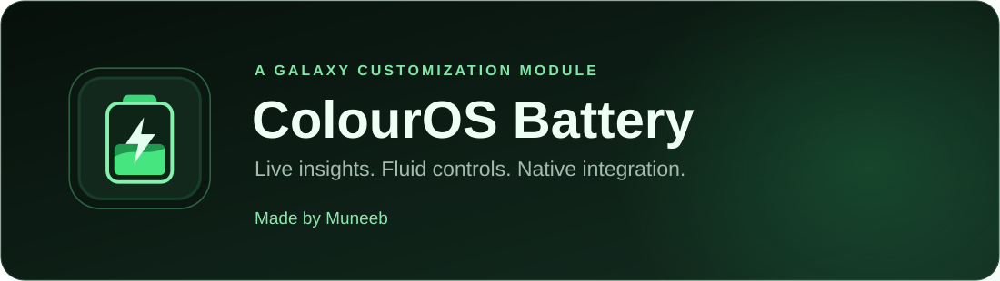

<div align="center">



[](https://github.com/muneebranjha10/Colour-os-settings/actions/workflows/build.yml)
[](https://github.com/muneebranjha10/Colour-os-settings/releases)


**A ColorOS-inspired battery experience, integrated into Samsung Device Care.**

[Download APK](https://github.com/muneebranjha10/Colour-os-settings/releases) · [Report a bug](https://github.com/muneebranjha10/Colour-os-settings/issues/new)

</div>

## Overview

ColourOS Battery replaces the appearance of the supported native Battery activity with a custom dashboard while preserving access to Samsung's original controls. This is an independent community project, not an official Samsung or OPPO product.

## Features

| Dashboard | Custom studio |
| --- | --- |
| Live battery percentage and charging estimates | Three green glass strengths |
| Battery-side charging power and recent graph | Adjustable animation speed |
| ASOC, BSOH and cycle count with source labels | Draggable performance and charging selectors |
| Inline battery protection on supported firmware | Optional haptics and wattage display |
| Native charging and power settings | Low Power UI and monitor visibility |
| Temperature and charge-target alerts (page only) | Compatibility report |

Battery-side wattage is not wall or charger output. Health values are firmware estimates; unavailable readings are not fabricated. Inline charging protection requires recognized settings. Some controls open Samsung's native settings rather than applying changes directly.

## Compatibility

| Environment | Status |
| --- | --- |
| Galaxy S23 SM-S911B, One UI 9 | Original development target; earlier builds tested by the author |
| One UI 8 | Community-reported working on earlier builds; model coverage unknown |
| Other Samsung Galaxy devices | Experimental, dependent on Device Care activity and permissions |
| Non-Samsung devices / unrooted devices | Unsupported |

The branded v1.1 RC2 is a public testing release, not a universal compatibility certification. Firmware-specific helpers are restricted to the original test model and recognized API levels; other devices use native settings fallback. No system-wide icon hooks or charging firmware modifications.

## Installation

1. Download the latest APK from [Releases](https://github.com/muneebranjha10/Colour-os-settings/releases).
2. Install the APK and enable **ColourOS Battery** in LSPosed.
3. Select **Samsung Device Care** (`com.samsung.android.lool`) only.
4. Reboot and open **Settings → Battery**.

If the APK cannot update because of a signature mismatch, uninstall the previous module first. CI uses a debug signature that can differ between runs. Re-enable the module and scope after reinstalling.

## Troubleshooting & recovery

- If the UI does not appear, check the LSPosed scope and Device Care version.
- If a control is unavailable, use the original Samsung Battery settings.
- To return to the original interface, use the overflow menu or disable the module and reboot.
- When reporting a bug, include your Galaxy model, Android/One UI version, Device Care version, steps to reproduce, and relevant LSPosed logs with personal data removed.

The previously reported Balanced-mode issue has not been investigated further and may persist. User-selected Samsung settings are not reset by uninstalling the module.

## Build & verification

```sh
gradle :app:testDebugUnitTest :app:assembleDebug --no-daemon
```

GitHub Actions runs ten automated regression checks, builds the APK and verifies its signature and LSPosed entry. These checks do not replace device testing or validate every glass effect. No network permission or permanent background service is required.

---

<div align="center">


**Made by Muneeb**

</div>
