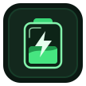

<div align="center">


[](https://github.com/muneebranjha10/Colour-os-settings/actions/workflows/build.yml)
[](https://github.com/muneebranjha10/Colour-os-settings/releases)


**A ColorOS-inspired battery experience, integrated into Samsung Device Care.**

[Download APK](https://github.com/muneebranjha10/Colour-os-settings/releases) · [Report a bug](https://github.com/muneebranjha10/Colour-os-settings/issues/new)

</div>

## Public Beta 1

This separate test branch is based on RC10. The first visit to the Battery page displays a warning before the custom dashboard. Continue saves an acknowledgment in Device Care preferences; it survives reopening and rebooting. Clearing Device Care data may reset it. Both builds use the same module package to avoid simultaneous hooks; install only one. The main branch and RC10 release are unchanged.

## Overview

ColourOS Battery replaces the appearance of the supported native Battery activity with a custom dashboard while preserving access to Samsung's original controls. This is an independent community project, not an official Samsung or OPPO product.

## Features

| Dashboard | Custom studio |
| --- | --- |
| Live battery percentage and charging estimates | Three selectable glass palettes |
| Battery-side charging power and recent graph | Adjustable animation speed |
| ASOC, BSOH and cycle count with source labels | Draggable, filled morphing power and charging selectors |
| Inline battery protection on supported firmware | Optional haptics and wattage display |
| Native charging and power settings | Low Power UI and monitor visibility |
| Temperature and charge-target alerts (page only) | Compatibility report |

Battery-side wattage is not wall or charger output. Health values are firmware estimates; unavailable readings are not fabricated. Inline charging protection requires recognized settings. Some controls open Samsung's native settings rather than applying changes directly.

### Crystal glass and motion

RC5 introduced a continuously tracking charge limit thumb with press expansion, four-step snapping on release, animated Basic/Maximum and usage tabs, and a spring-based crystal glass renderer with moving specular highlights. These are iOS-inspired optical approximations, not Apple's compositor or a copy of its proprietary effects. Native battery limits remain 80/85/90/95%. Dashboard polling yields during drag.


Battery Health now opens and closes with a brief same-window crossfade, without dashboard scaling or parallax. The back button and system back trigger the animated return. Module dialogs have soft entrance motion, rows have touch ripples, and the battery dashboard has an animated entrance and toolbar-back exit. Low Power UI reduces transitions to a short fade; system-disabled animators skip these effects. Native Samsung pages retain their own transitions.

### RC6 touch rendering fix

Removed the stationary rectangular Android press ripple from the power, charging, protection and usage glass selectors. Their moving glass remains the only touch selection effect. Other custom rows use a rounded ripple mask. Keyboard focus remains visible. The fix does not change native power mode activation logic.

### RC7 ColorOS refinement

Neutral charcoal and silver glass, restrained green selection accents, a white/silver charge-limit thumb, and an in-window Battery Health crossfade. The dashboard stays stationary when returning; polling pauses while health is open. Toolbar/system back share the close path (legacy fallback is scoped to BatteryActivity). Native Samsung pages retain their own transitions.

### RC8 Classic Flow

Classic green glass, original emerald and neutral silver options; Smooth motion uses 22% longer base timing and Relaxed 60% longer. Lower settings share aligned adaptive rows. Health refreshes every 30 seconds (60 in Low Power UI) while visible and focused. Readings show source and check time; live kernel counters take precedence. Samsung saved values are distinguished from live ASOC. Firmware may update cycles infrequently; no synthetic increments or assumption of 100% health. Imported snapshots pause automatic refresh until manual refresh or reopening. No new root grants.

### RC9 Motion Sync

Glass selection and icon/label colors now follow the same visual clock; real settings confirmation still determines the logical selected mode. Cached gradients avoid per-frame shader matrix changes and the secondary dialog content animation was removed. The first RC9 launch migrates saved Fast to Smooth (Fast remains selectable). Native pages retain their OS transitions. All Samsung Galaxy models are targeted, compatibility remains in testing.

### RC10 Liquid Lens experiment

Only the selector renderer changes: time-based finger-following tail, rounded rest geometry, damped settling, and optional GPU optical bending of analytically reconstructed local tile edges (Android 13+ hardware Canvas). No screenshot or screen-wide refraction, no new dashboard features or palette changes. Cached Canvas gradient fallback is retained for low-power mode or shader failure. Actual GPU shader execution and frame rate need device testing.

## Compatibility

**All Samsung Galaxy devices are targeted for support — compatibility is still in testing.** Root and LSPosed are required. This is not a guarantee that every model or firmware works yet.

| Environment | Status |
| --- | --- |
| Galaxy S23 SM-S911B, One UI 9 | Original development target; earlier builds tested by the author |
| One UI 8 | Community-reported working on earlier builds; model coverage unknown |
| Other Samsung Galaxy devices | Experimental, dependent on Device Care activity and permissions |
| Non-Samsung devices / unrooted devices | Unsupported |

The v1.1 Public Beta 2 is a public testing release, not a universal compatibility certification. Firmware-specific helpers are restricted to the original test model and recognized API levels; other devices use native settings fallback. No system-wide icon hooks or charging firmware modifications.

## Installation

1. Download the latest APK from [Releases](https://github.com/muneebranjha10/Colour-os-settings/releases).
2. Install the APK and enable **ColourOS Battery** in LSPosed.
3. Select **Samsung Device Care** (`com.samsung.android.lool`) only.
4. Reboot and open **Settings → Battery**.

If the APK cannot update because of a signature mismatch, uninstall the previous module first. CI uses a debug signature that can differ between runs. Re-enable the module and scope after reinstalling.

## Troubleshooting & recovery

- If the UI does not appear, check the LSPosed scope and Device Care version.
- If a control is unavailable, use the original Samsung Battery settings.
- To return to the original interface, use the overflow menu or disable the module and reboot.
- When reporting a bug, include your Galaxy model, Android/One UI version, Device Care version, steps to reproduce, and relevant LSPosed logs with personal data removed.

The previously reported Balanced-mode issue has not been investigated further and may persist. User-selected Samsung settings are not reset by uninstalling the module.

## Build & verification

```sh
gradle :app:testDebugUnitTest :app:assembleDebug --no-daemon
```

GitHub Actions runs forty-four automated regression checks, builds the APK and verifies its signature and LSPosed entry. These checks do not replace device testing or validate every glass effect. No network permission or permanent background service is required.

---

<div align="center">



**Made by Muneeb**

</div>


Public beta testers: report problems via [GitHub Issues](https://github.com/muneebranjha10/Colour-os-settings/issues). The beta notice is not displayed in RC10.


### Public Beta 2 — Liquid Battery

Tap the battery bar to expand a read-only live battery detail card. Status accents: green normal, blue active charging, amber power saving, red at or below 15 percent (charging takes priority). Optional wave runs only while visibly charging; both effects can be disabled in Customize appearance. Beta 1 acknowledgment is reused. No new root operations, background services or battery controls.
